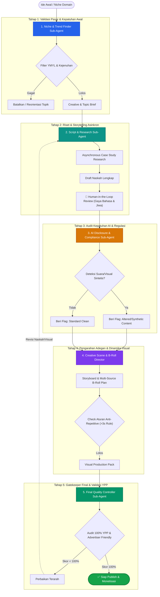

# Visual Pipeline Produksi Konten YouTube Faceless & Kepatuhan Monetisasi

Dokumen ini memetakan arsitektur pipeline produksi multi-agent berdasarkan standar [`skill.md`](file:///d:/projects/YT-Faceless-Automation/.agents/skills/youtube-monetization/skill.md) untuk memastikan konten 100% aman dari dismonetisasi (*reused/repetitive content* dan pedoman pengiklan).

---

## 🗺️ Visual Architecture Pipeline

---

## 🤖 Spesifikasi 5 Sub-Agent

### 1. Niche & Trend Finder Agent
- **Tanggung Jawab:** Validasi topik dengan rasio demand tinggi dan saturasi rendah.
- **Guardrail Kepatuhan:** Memblokir topik YMYL berbahaya (klaim finansial cepat kaya, saran medis berbahaya).
- **Format Output:** Topic Brief (Target Audience, Unsold Angle, Resiko Regulasi).

### 2. Script & Research Agent
- **Tanggung Jawab:** Menyusun narasi berbasis *hook* emosional, perbandingan kritis, dan penyusunan cerita dramatis.
- **Guardrail Kepatuhan:** Mengeliminasi frasa AI klise (*"Pernahkah Anda berpikir..."*, *"Dalam era modern..."*), menyuntikkan orisinalitas di 30 detik pertama.
- **Format Output:** Script Lengkap dengan penanda segmen waktu & emosi audio.

### 3. AI Disclosure & Compliance Agent
- **Tanggung Jawab:** Memindai risiko *synthetic media* sesuai aturan transparansi YouTube.
- **Guardrail Kepatuhan:** Menentukan apakah video memerlukan penandaan biner *"Altered or Synthetic Content"* pada YouTube Creator Studio.
- **Format Output:** Compliance Ledger & Disclosure Checklist.

### 4. Creative Scene & B-Roll Director
- **Tanggung Jawab:** Mengonversi narasi menjadi panduan *storyboard* dinamis dengan minimal 3 lapisan visual per 10 detik.
- **Guardrail Kepatuhan:** Tidak boleh ada gambar statis >3 detik tanpa *motion* (*pan/zoom*), rotasi sumber aset (stok klip, grafik data, tipografi kinetik) untuk mematahkan deteksi *repetitive content*.
- **Format Output:** JSON/Markdown Scene Manifest (Waktu, Visual Cue, Motion Directive, Sound FX).

### 5. Final Quality Controller (Gatekeeper Agent)
- **Tanggung Jawab:** Evaluasi ambang 100% kelayakan monetisasi.
- **Guardrail Kepatuhan:** Melarang kata sensitif, memeriksa hak cipta musik, orisinalitas nada suara, serta sinkronisasi nilai tambah.
- **Format Output:** QC Scorecard & Final Release Approval.
